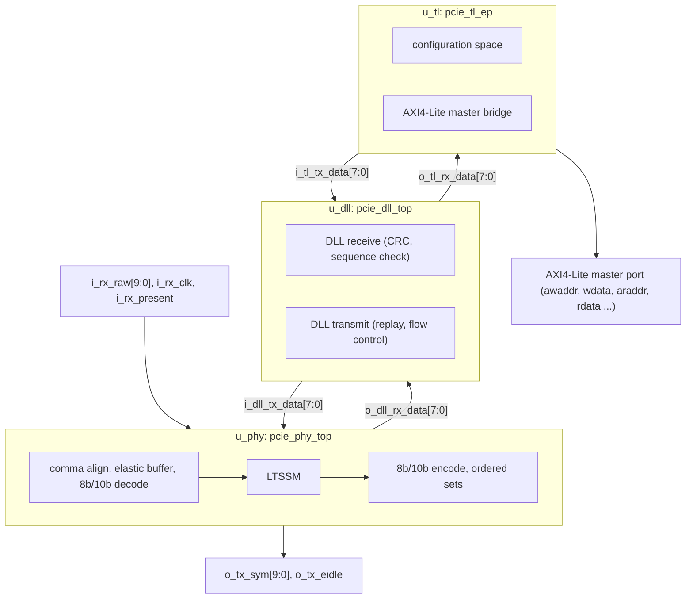

# PCIe Endpoint (PHY, Data Link and Transaction Layers) on Virtex-7 (part No: xc7vx485tffg1930-2L)

**RTL Design | System Verilog | Verification | FPGA**

## Contents

- [Overview](#overview)
- [Target Device](#target-device)
- [Architecture](#architecture)
- [Subcomponents](#subcomponents)
- [Parameters](#parameters)
- [User I/O](#user-io)
- [Implementation Results](#implementation-results)
- [XDC Constraints](#xdc-constraints)
- [Timing Summary](#timing-summary)
- [Power Summary](#power-summary)
- [Implementation Notes](#implementation-notes)
- [Verification](#verification)
- [Project Files](#project-files)

## Overview

This project implements a PCIe-style endpoint stack in SystemVerilog, organized into the three PCI Express layers: a physical layer (PHY) with 8b/10b coding, comma alignment, an elastic buffer and a link training state machine (LTSSM); a data link layer (DLL) with TLP transmit/receive, replay and flow-control updates; and an endpoint transaction layer (TL) with a configuration space. The transaction layer turns incoming memory requests into AXI4-Lite master transactions (32-bit address and data) toward a register file. The design is built around a 10-bit symbol interface (`i_rx_raw` / `o_tx_sym`) rather than a serial transceiver.

> **Note:** the RTL comes from the open-source `PCI-e_NNF` repository (`rtl/` and `tb/` folders), which is used here as the design under study. It runs on ordinary FPGA I/O: no GTX transceivers are used.

## Target Device

| Item | Value |
|---|---|
| Device | xc7vx485tffg1930-2L (Virtex-7 VX485T) |
| Package / speed grade | FFG1930 / -2L |
| Tool | Vivado v2026.1 |
| Top module | `pcie_ep_top` (simulation top: `tb_pcie_top`) |
| Device resources | 303,600 LUTs, 607,200 flip-flops, 1,030 RAMB36, 2,800 DSP, 700 bonded IOB |

## Architecture

`pcie_ep_top` instantiates three blocks in a chain: `u_phy` (`pcie_phy_top`), `u_dll` (`pcie_dll_top`) and `u_tl` (`pcie_tl_ep`). Symbols received on `i_rx_raw` are decoded and aligned by the PHY and passed up as bytes to the DLL, which checks the packets and hands TLPs to the TL. The TL answers configuration requests from its configuration space and forwards memory reads and writes on the AXI4-Lite master port. In the other direction, TL completions go down through the DLL and PHY and leave as 10-bit symbols on `o_tx_sym`.



*Layer structure of the PCIe endpoint, following the instances in the schematic.*


*Synthesized schematic from Vivado: `u_phy` (PHY), `u_dll` (data link layer) and `u_tl` (transaction layer).*

## Subcomponents

The design hierarchy has **3 top-level blocks** under `pcie_ep_top` and **14 modules in total** (including the top):

| Layer | Module | Function |
|---|---|---|
| Top | `pcie_ep_top` | Connects PHY, DLL and TL |
| PHY | `pcie_phy_top` | PHY wrapper (`u_phy`) |
| PHY | `pcie_phy_tx` | Symbol transmit with ordered-set and packet state machines |
| PHY | `pcie_phy_rx` | Symbol receive path |
| PHY | `pcie_8b10b_enc` / `pcie_8b10b_dec` | 8b/10b encoder and decoder |
| PHY | `pcie_comma_align` | Comma detection and symbol alignment |
| PHY | `pcie_elastic_buf` | Elastic buffer between receive and local clock |
| PHY | `pcie_ltssm` | Link training and status state machine |
| DLL | `pcie_dll_top` | DLL wrapper (`u_dll`) with link-up state machine |
| DLL | `pcie_dll_tx` / `pcie_dll_rx` | TLP transmit with replay, and receive with CRC and sequence checking |
| TL | `pcie_tl_ep` | Endpoint transaction layer (`u_tl`) |
| TL | `pcie_cfg_space` | Configuration space registers |

Supporting files in the project: `pcie_pkg.sv` (shared package), `axil_regfile.sv` (AXI4-Lite register file used as the example target), and the testbench models `pcie_channel.sv` (link model), `pcie_rc_bfm.sv` (root complex bus-functional model), `tb_pcie_top.sv` and the unit tests `tb_phy_link.sv`, `tb_8b10b.sv` and `tb_crc_scrambler.sv`.

Vivado inferred **5 state machines**: the LTSSM (`o_state_reg`, sequential encoding), the PHY transmitter ordered-set (`os_st_reg`, sequential) and packet (`pk_st_reg`, one-hot) machines, the DLL transmit machine (`ig_reg`, sequential) and the DLL link state (`o_dl_state_reg`, one-hot). The RTL statistics list 37 x 32-bit, 8 x 16-bit, 21 x 12-bit and 64 x 8-bit registers, 157 x 16-bit and 35 x 32-bit XOR trees (CRC and scrambler logic), and RAMs of 2048 x 10 bit, 2048 x 8 bit, 32 x 10 bit and three of 8 x 12 bit.

## Parameters

| Parameter | Value | Meaning |
|---|---|---|
| `VENDOR_ID` | 16'h1234 | Configuration-space vendor ID |
| `DEVICE_ID` | 16'h0001 | Configuration-space device ID |
| `CLASS_CODE` | 24'h120000 | Configuration-space class code |
| `BAR0_BITS` | 12 | BAR0 size (2^12 bytes = 4 KB) |
| `DOWNSTREAM` | 0 | Endpoint (upstream-facing) mode |
| `LINK_NUM` | 0 | Link number advertised in training |
| `T_2MS` / `T_24MS` / `T_48MS` | 500,000 / 6,000,000 / 12,000,000 | LTSSM timeouts in clock cycles (these counts correspond to a 250 MHz symbol clock) |
| `T_DETECT_QUIET` | 3,000,000 | Detect.Quiet timeout in clock cycles |
| `POLL_TS1_MIN` | 1,024 | Minimum TS1 ordered sets in the polling state |
| `REPLAY_TIMEOUT` | 3,000 | DLL replay timer in clock cycles |
| `UPDATEFC_PERIOD` | 7,500 | Interval between flow-control updates in clock cycles |
| `ADV_PH` / `ADV_PD` | 8 / 64 | Advertised posted header / data credits |
| `ADV_NPH` / `ADV_NPD` | 8 / 8 | Advertised non-posted header / data credits |
| `ADV_CPLH` / `ADV_CPLD` | 0 / 0 | Advertised completion credits (unlimited) |
| `RB_EW` / `RB_AW` / `AW` | 3 / 11 / 11 and 5 | Elastic-buffer and RAM address widths |

## User I/O

| Group | Signals | Direction | Bits |
|---|---|---|---|
| Clocks, reset, link | `i_clk`, `i_rx_clk`, `i_rst`, `i_rx_present` | In | 4 |
| Receive symbols | `i_rx_raw[9:0]` | In | 10 |
| AXI4-Lite master inputs | `i_m_axil_awready`, `wready`, `bvalid`, `bresp`, `arready`, `rvalid`, `rdata[31:0]`, `rresp` | In | 38 used |
| Transmit symbols | `o_tx_sym[9:0]`, `o_tx_eidle` | Out | 11 |
| Link status | `o_link_up`, `o_dl_up`, `o_ltssm_state[3:0]` | Out | 6 |
| Statistics and ID | `o_stat_bad_tlp[15:0]`, `o_stat_replays[15:0]`, `o_completer_id[15:0]` | Out | 48 |
| AXI4-Lite master outputs | `awaddr[31:0]`, `awvalid`, `wdata[31:0]`, `wstrb[3:0]`, `wvalid`, `bready`, `araddr[31:0]`, `arvalid`, `rready` | Out | 105 |

**Totals:** **222 user I/Os** (52 inputs, 170 outputs), which is 31.71% of the 700 bonded IOBs on the device.

## Implementation Results

| Resource | Used | Available | Util % |
|---|---|---|---|
| Slice LUTs (all) | 3,247 | 303,600 | 1.07 |
| LUT as logic | 2,375 | 303,600 | 0.78 |
| LUT as memory (distributed RAM) | 872 | 130,800 | 0.67 |
| Slice registers (flip-flops) | 2,520 | 607,200 | 0.42 |
| F7 muxes | 129 | 151,800 | 0.08 |
| F8 muxes | 32 | 75,900 | 0.04 |
| Slices | 1,271 | 75,900 | 1.67 |
| Block RAM | 0 | 1,030 | 0.00 |
| DSP | 0 | 2,800 | 0.00 |
| GTX transceivers | 0 | 28 | 0.00 |
| Bonded IOB | 222 | 700 | 31.71 |
| BUFGCTRL | 2 | 32 | 6.25 |
| Unique control sets | 203 | 75,900 | 0.27 |

All memories were mapped to distributed RAM (0 block RAM). Synthesis finished with 0 errors, 0 critical warnings and 28 warnings.

## XDC Constraints

The constraint file (`PCIE_Constraints.xdc`) defines a 100 MHz clock on `i_clk` (10.000 ns, waveform {0.000 5.000}), a 5 pF load on all outputs and a small set of pin assignments. The listing below is reconstructed from the constraints Vivado recorded for this run.

```tcl
# Clock (as reported by Vivado): i_clk, period 10.000 ns, waveform {0.000 5.000}
set_load 5.000 [all_outputs]
set_property LOAD 5 [get_ports {o_completer_id[*]}]    ;# applied to every output port

set_property PACKAGE_PIN H17 [get_ports i_rst]
set_property PACKAGE_PIN H15 [get_ports i_rx_present]
set_property PACKAGE_PIN H12 [get_ports i_m_axil_awready]
set_property PACKAGE_PIN J17 [get_ports i_m_axil_wready]
set_property PACKAGE_PIN J14 [get_ports o_tx_eidle]
set_property PACKAGE_PIN C15 [get_ports o_m_axil_bready]
set_property PACKAGE_PIN F14 [get_ports o_m_axil_rready]
set_property PACKAGE_PIN G15 [get_ports o_link_up]
set_property PACKAGE_PIN F10 [get_ports o_dl_up]
set_property -dict {PACKAGE_PIN J21 IOSTANDARD LVCMOS18} [get_ports o_m_axil_arvalid]
```

Only 10 of the 222 I/Os have a pin assignment in the file; the rest were placed by the tool. The file also contains Tcl commands that are not valid in an XDC file (`synth_design`, `place_design`, `route_design` and `power_opt_design`), and the `set_load` commands could not be applied during synthesis. Together these produce the 106 critical warnings reported for the run. The receive clock `i_rx_clk` has no clock constraint.

## Timing Summary

All user-specified timing constraints are met on the constrained 100 MHz clock: worst setup slack is +3.188 ns, worst hold slack is +0.043 ns and worst pulse-width slack is +4.232 ns, with no failing endpoints.

| Check | Worst slack | Total negative slack | Failing endpoints | Total endpoints |
|---|---|---|---|---|
| Setup (WNS / TNS) | 3.188 ns | 0.000 ns | 0 | 11,675 |
| Hold (WHS / THS) | 0.043 ns | 0.000 ns | 0 | 11,675 |
| Pulse width (WPWS / TPWS) | 4.232 ns | 0.000 ns | 0 | 3,351 |


*Vivado Design Timing Summary (routed design).*

## Power Summary

Total on-chip power is 0.285 W. Static power is 85% of the total, and 49% of the dynamic power is in the I/O.

| Metric | Value |
|---|---|
| Total on-chip power | 0.285 W |
| Dynamic power | 0.043 W (15%) |
| Dynamic: clocks | 0.009 W (21%) |
| Dynamic: signals | 0.008 W (18%) |
| Dynamic: logic | 0.005 W (12%) |
| Dynamic: I/O | 0.021 W (49%) |
| Device static power | 0.242 W (85%) |
| Junction temperature | 25.2 °C |
| Thermal margin | 74.8 °C (84.0 W) |
| Ambient temperature | 25.0 °C |
| Effective θJA | 0.9 °C/W |
| Design power budget | Not specified |
| Process | typical |
| Confidence level | Low |


*Vivado power analysis of the implemented netlist (vectorless activity, so confidence is low).*

## Implementation Notes

| Check | Severity | Meaning in this design |
|---|---|---|
| NSTD-1 | Critical Warning | I/O standard not specified for most ports (default used) |
| UCIO-1 | Critical Warning | Ports have no pin constraint |
| TIMING-17 | Critical Warning | 82 sequential cells are not clocked by a constrained clock (the unconstrained `i_rx_clk` domain) |
| TIMING-18 | Warning | 211 ports have no input or output delay |
| CFGBVS-1 | Warning | `CFGBVS` and `CONFIG_VOLTAGE` are not set |

## Verification

The testbench (`tb_pcie_top.sv`) connects a root-complex bus-functional model (`ep_*` and `rc_*` sides with separate clocks and resets) through a channel model, and monitors `err_rc2ep`, `err_ep2rc` and a `force_retrain` control. In the captured 0 to 240 ns window, the endpoint reset is released at about 100 ns and the root complex reset at about 135 ns. After each release the transmit symbol buses leave zero and start carrying symbols (`0x0b9` is shown), both error flags stay low and `force_retrain` stays low. Link training and the AXI4-Lite transactions happen later than this window, so they are not visible in the capture.


*Simulation waveform, 0 to 240 ns.*

## Project Files

The project is built from the following files (the RTL and testbenches live in the `PCI-e_NNF` repository folder):

- PHY: `pcie_phy_top.sv`, `pcie_phy_tx.sv`, `pcie_phy_rx.sv`, `pcie_ltssm.sv`, `pcie_comma_align.sv`, `pcie_elastic_buf.sv`, `pcie_8b10b_enc.sv`, `pcie_8b10b_dec.sv`.
- DLL: `pcie_dll_top.sv`, `pcie_dll_tx.sv`, `pcie_dll_rx.sv`.
- TL and top: `pcie_tl_ep.sv`, `pcie_cfg_space.sv`, `pcie_ep_top.sv`, `pcie_pkg.sv`, `axil_regfile.sv`.
- Testbench: `tb_pcie_top.sv`, `pcie_channel.sv`, `pcie_rc_bfm.sv`, `tb_phy_link.sv`, `tb_8b10b.sv`, `tb_crc_scrambler.sv`.
- Constraints: `PCIE_Constraints.xdc`.

---

&copy; 2026 Aravindakshan GA. All rights reserved.
